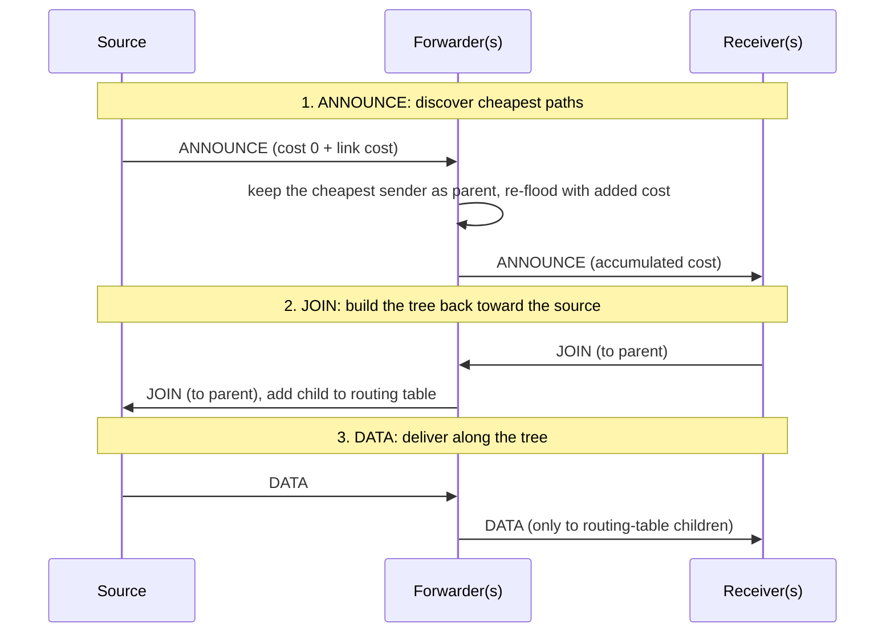
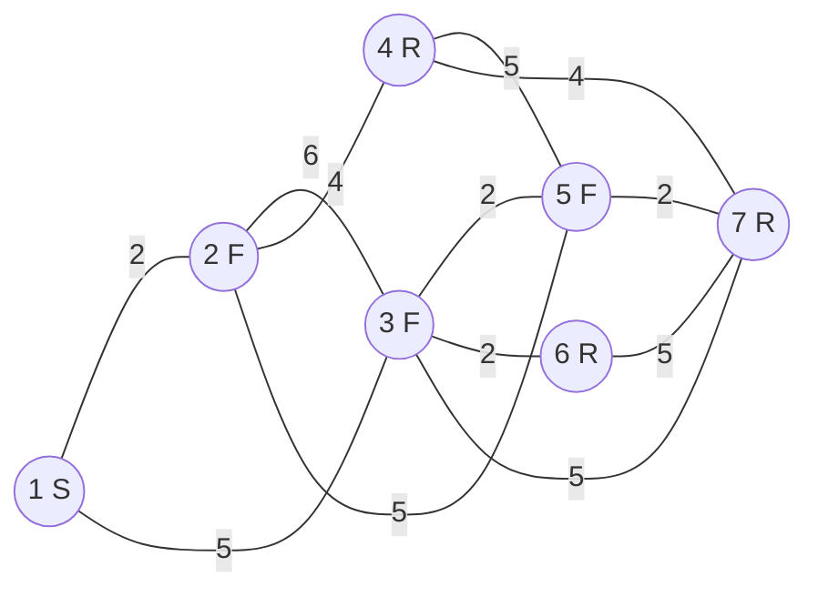

# Minimum-Cost Routing Tree

A distributed routing simulation in Python: seven independent nodes connected over TCP work out the cheapest way to deliver a message from one sender to a group of receivers, then deliver it along that tree, with no central coordinator.

## Tech Stack

Python (standard library only) · TCP sockets · multithreading · JSON messages

## Features

- **Self-organizing tree**: nodes discover the lowest-cost path back to the source by flooding cost announcements, using only what their direct neighbors tell them.
- **Three node roles**: a **source** that sends, **forwarders** that relay, and **receivers** that want the data.
- **Efficient delivery**: data only travels along branches that lead to a receiver, not to every node.
- **Duplicate suppression**: every message has a unique ID, so loops in the network never cause repeats.
- **Configurable topologies**: three ready-made role layouts on the same 7-node network, plus one JSON config per node.
- **One-command demo**: `run_all.py` starts all seven nodes and prints each node's routing table and received data.

## Architecture



Each node is its own process with a TCP server and a connection to each neighbor. The source floods an **ANNOUNCE**; every node remembers whichever neighbor offered the lowest total cost as its parent. Receivers then send a **JOIN** up through their parents, which builds each node's routing table. Finally the source sends **DATA**, which follows only those routing-table branches.

**Example (topology 1):** the network below, with node 1 as source and nodes 4, 6, 7 as receivers. Labels are link costs.



## Getting Started

**Prerequisites:** Python 3 (verified on 3.11). No packages to install.

```bash
python run_all.py 1          # run topology 1 (also 2 or 3) for ~15 s, then stop
```

Every receiver prints `consumed DATA: Hello group G1!`, and each node prints its routing table.

To run nodes by hand instead (one terminal per node, all started within ~2 s of each other):

```bash
python generate_topology.py 1      # write config1.json … config7.json
python node.py config1.json        # repeat for config2.json … config7.json
```

On Windows, `allnodes.bat` opens one window per node.

## Technical Decisions & Challenges

- **Distance-vector style discovery.** No node knows the whole map; each one only compares the costs its neighbors advertise, which is how real routing protocols scale.
- **Reverse-path tree.** Receivers join toward the source along the cheapest path they discovered, so the delivery tree is built from the receivers' side and only includes useful branches.
- **Newline-delimited JSON over TCP.** TCP is a byte stream, so messages are separated by newlines and partial reads are buffered until a full message arrives.
- **Ties are allowed.** When two paths cost the same, whichever announcement arrives first wins, which is still a valid lowest-cost tree.

## Limitations

- Phases are coordinated with fixed delays (startup, JOIN, DATA), so all nodes must start within a couple of seconds of each other.
- Runs on a single machine, and there's no handling for nodes that fail mid-run.

## Next Steps

- Replace fixed delays with acknowledgements so each phase starts when the previous one actually finishes.
- Detect failed neighbors with heartbeats and rebuild the tree around them.
- Support several groups and sources at once, plus receivers leaving (tree pruning).
- Run nodes on separate machines by making host addresses configurable.

## Credits

Built as a team project (2 members).

## License

[MIT](LICENSE)
